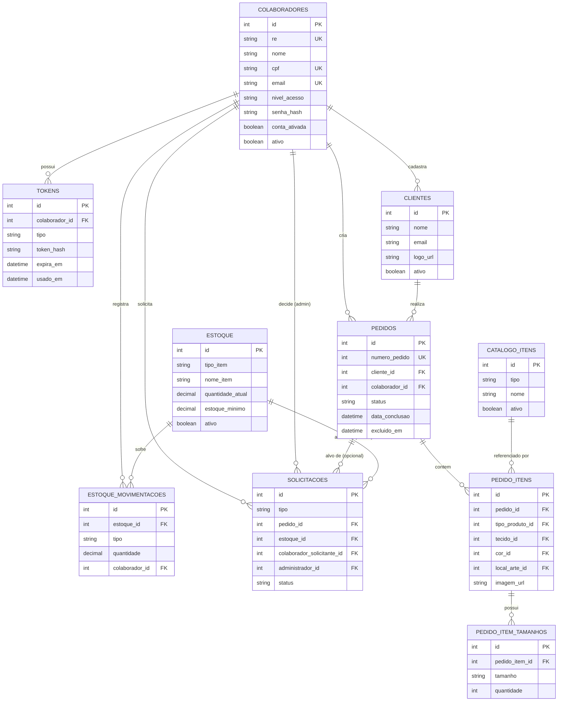

# E-Threads — Arquitetura Aprovada (TCC SENAI 2026)

> Documento de referência para implementação. Reflete a arquitetura discutida e aprovada entre o Tech Lead e o arquiteto do projeto. Não contém SQL executável nem código — serve para orientar as tarefas registradas em `docs/ACOMPANHAMENTO_REQUISITOS.md`.

## 1. Visão geral

- Frontend: React + Vite + JavaScript (`src/`).
- Backend: Python + Flask (`backend/`), sem ORM — acesso direto via `mysql.connector`.
- Banco de dados: MySQL (relacional), modelado do zero — nenhuma tabela existente hoje é considerada definitiva.
- Imagens: Cloudinary. E-mail: Gmail (`tccgrupo0110@gmail.com`) via SMTP.
- Autenticação: RE + senha, com sessão Flask (cookie `HttpOnly`).

## 2. Modelo de dados — 10 tabelas

### 2.1 Diagrama entidade-relacionamento



### 2.2 Tabelas, campos e regras

**colaboradores** — usuários do sistema (admin e colaborador)
`id PK · re VARCHAR(20) UNIQUE NOT NULL · nome · cpf UNIQUE · email UNIQUE NOT NULL · telefone · endereco · nivel_acesso ENUM('administrador','colaborador') · senha_hash NULL · conta_ativada BOOLEAN DEFAULT 0 · ativo BOOLEAN DEFAULT 1 · data_contrato · salario · preferencia_notificacoes · created_at`
- `senha_hash` fica nulo até a ativação da conta. `conta_ativada` (concluiu `/definir-senha`) é independente de `ativo` (ligado/desligado pelo admin).

**tokens** — tokens de ativação e redefinição de senha
`id PK · colaborador_id FK→colaboradores.id · tipo ENUM('ativacao','redefinicao') · token_hash · expira_em · usado_em NULL · created_at`
- Um único modelo cobre os dois fluxos (hoje só existe ativação).

**clientes**
`id PK · nome · email · telefone · endereco · logo_url (Cloudinary) · ativo BOOLEAN DEFAULT 1 · created_at`

**catalogo_itens** — catálogo administrável de produtos/tecidos/cores/locais/personalizações
`id PK · tipo ENUM('produto','personalizacao','tecido','cor','local') · nome · ativo BOOLEAN DEFAULT 1 · created_at` · `UNIQUE(tipo, nome)`
- Nunca é excluído de verdade (`ON DELETE RESTRICT` protege itens em uso por pedidos); só inativado.
- O `tipo` da linha referenciada por cada FK de `pedido_itens` (ex.: `tecido_id` deve apontar para `tipo='tecido'`) é validado na aplicação, não no banco — FK garante só que o `id` existe.

**pedidos**
`id PK · numero_pedido INT UNIQUE · cliente_id FK→clientes.id · colaborador_id FK→colaboradores.id (criador) · data_pedido · prazo_entrega · prioridade ENUM('baixa','media','alta') · obs_geral · status ENUM('pendente','em_producao','concluido','cancelado') DEFAULT 'pendente' · data_conclusao DATETIME NULL · excluido_em DATETIME NULL · created_at · updated_at`
- `status` representa o ciclo de **produção/negócio** (`cancelado` = decisão administrativa de interromper o pedido).
- `excluido_em` é **independente** de `status`: só é preenchido quando uma solicitação de exclusão é aprovada. Um pedido pode estar `concluido` e depois excluído, ou `cancelado` sem nunca ter sido excluído.
- `data_conclusao` é preenchido quando `status` muda para `concluido` — necessário para os relatórios mensais.

**pedido_itens**
`id PK · pedido_id FK→pedidos.id · tipo_produto_id FK→catalogo_itens.id · personalizacao_id FK→catalogo_itens.id NULL · tecido_id FK→catalogo_itens.id · cor_id FK→catalogo_itens.id · local_arte_id FK→catalogo_itens.id · observacao · imagem_url (Cloudinary)`

**pedido_item_tamanhos**
`id PK · pedido_item_id FK→pedido_itens.id · tamanho VARCHAR(10) · quantidade INT`

**estoque**
`id PK · tipo_item ENUM('produto','material') · nome_item · categoria · unidade_medida · fornecedor · quantidade_atual DECIMAL(10,2) · estoque_minimo DECIMAL(10,2) · valor_unitario DECIMAL(10,2) · observacoes · ativo BOOLEAN DEFAULT 1 · created_at`
- `CHECK (quantidade_atual >= 0)`.
- Status exibido na tela (disponível/baixo/indisponível) é **calculado na consulta** (`quantidade_atual` vs `estoque_minimo`), não é coluna.
- Soft delete (`ativo=0`) — hoje o código faz `DELETE` real; isso muda.

**estoque_movimentacoes**
`id PK · estoque_id FK→estoque.id · tipo ENUM('entrada','saida') · quantidade DECIMAL(10,2) · motivo · colaborador_id FK→colaboradores.id · data TIMESTAMP DEFAULT NOW()`
- Toda mudança em `estoque.quantidade_atual` passa por aqui, dentro da mesma transação (ver §7).

**solicitacoes**
`id PK · tipo ENUM('edicao','exclusao') · pedido_id INT NULL FK→pedidos.id · estoque_id INT NULL FK→estoque.id · colaborador_solicitante_id FK→colaboradores.id · dados_propostos JSON NULL · status ENUM('pendente','aprovada','recusada') DEFAULT 'pendente' · administrador_id FK→colaboradores.id NULL · data_solicitacao · data_decisao`
- `CHECK ((pedido_id IS NOT NULL AND estoque_id IS NULL) OR (pedido_id IS NULL AND estoque_id IS NOT NULL))` — garante no banco que a solicitação aponta para exatamente um alvo (pedido **ou** estoque), substituindo um campo polimórfico sem FK.
- **Dependência:** `CHECK` só é de fato aplicado em MySQL ≥ 8.0.16 / MariaDB ≥ 10.2.1 — confirmar a versão do SGBD antes de gerar o SQL; se for anterior, a regra também precisa ser validada na aplicação.
- A aplicação impede duas solicitações `pendente` simultâneas sobre o mesmo `pedido_id`/`estoque_id`.

## 3. Arquitetura do backend Flask e organização de pastas

Estrutura recomendada (reaproveitando o que já funciona, sem reescrever lógica de negócio):

```
backend/
  app.py                   # cria o app e registra os blueprints (existentes + novos)
  config.py                # novo — único lugar lendo variáveis de ambiente (SECRET_KEY, DB_*, SMTP_*)
  database/
    connection.py          # novo — pool de conexão (mysql.connector.pooling), cursor(dictionary=True)
    schema.sql             # reescrito do zero, única fonte de verdade para as 10 tabelas
  auth/
    decorators.py          # novo — login_required / admin_required
  blueprints/
    login.py, colaboradores.py, clientes.py, estoque.py      # arquivos de hoje, só movidos; lógica interna preservada
    pedidos.py, solicitacoes.py, catalogo.py, relatorios.py  # novos
  resources/
    seguranca.py, email_service.py   # reaproveitados sem mudança
  requirements.txt         # novo — hoje não existe
  .env.example             # novo — nomes de variáveis, sem segredos
```

- `cursor(dictionary=True)` substitui o cursor posicional atual — resolve o acesso por índice de array que hoje existe no frontend (`Clientes.jsx`), já que o backend passa a responder com JSON de campos nomeados.
- Mover os 4 blueprints existentes para `blueprints/` é uma reorganização opcional de baixo risco (só muda o local do arquivo e os imports em `app.py`); pode ser adiada se o time preferir manter tudo na raiz.

## 4. Autenticação: RE + senha com sessão Flask

- **Login** usa somente `re` (hoje o código aceita RE **ou** e-mail — isso será corrigido para seguir o requisito "somente RE e senha").
- **Mecanismo de sessão escolhido: cookie `HttpOnly`, `Secure` (produção), `SameSite=Lax`**, com o **frontend acessando a API através do proxy do Vite** (`vite.config.js` encaminha `/api/*` para o Flask), o que torna front e back a mesma origem para o navegador.
- **Por que não JWT em `localStorage`:** a aplicação tem upload de arquivos (logo de cliente, arte de pedido), o que aumenta a superfície de XSS. Um token em `localStorage` é legível por qualquer script injetado; um cookie `HttpOnly` não é acessível via JavaScript. O proxy do Vite elimina a única vantagem prática que o JWT teria (evitar configuração de cookie cross-origin).
- **Persistência:** a sessão Flask é um cookie assinado (`itsdangerous`), sem necessidade de tabela de sessões no banco. O frontend descobre se há sessão ativa chamando `GET /me` ao carregar a aplicação (retorna `nivel_acesso`/nome ou 401).
- **Logout:** `POST /logout` expira o cookie no servidor (`Set-Cookie: Max-Age=0`) — efeito imediato.
- **Proteção CSRF:** como a SPA só se comunica via `fetch`/`axios` (nunca formulário HTML) e o CORS do Flask passa a aceitar apenas a origem do próprio frontend, `SameSite=Lax` cobre a maior parte do risco. **Não há token CSRF dedicado implementado nesta fase** — é uma limitação aceita conscientemente para o escopo do TCC, documentada aqui para referência futura caso o time queira reforçar.
- **Limitação de revogação:** por ser um cookie assinado stateless (sem tabela de sessões ativas no banco), não é possível revogar uma sessão específica remotamente (ex.: "derrubar sessão de outro dispositivo") — só expira por tempo ou pelo próprio logout. Aceito como trade-off de simplicidade para o escopo do TCC.
- **Controle de acesso Administrador × Colaborador:** `nivel_acesso` é verificado em **todas** as rotas protegidas via decorators:
  - `@login_required` — exige sessão válida.
  - `@admin_required` — além da sessão, reconsulta `colaboradores.nivel_acesso` e `ativo` no banco (não confia em dado já carregado em memória/sessão), impedindo que um admin desativado/rebaixado durante a sessão continue agindo.
  - O React adapta a navegação (esconder "Painel Adm", por exemplo), mas a autorização de verdade é sempre no backend — hoje nenhuma rota além do login confere isso.

## 5. Cadastro de usuários, geração de RE e ativação por e-mail

1. Admin autenticado (`@admin_required`) cadastra colaborador (nome, e-mail, perfil).
2. Backend gera um **RE único** automaticamente (formato exato a definir — pendência registrada em §9) e grava em `colaboradores` com `senha_hash NULL`, `conta_ativada=0`.
3. Backend cria um registro em `tokens` (`tipo='ativacao'`), guardando o hash do token (nunca o valor puro), com expiração curta.
4. E-mail enviado ao colaborador com o RE e o link de ativação (via Gmail/SMTP — fluxo já implementado em `resources/email_service.py`, reaproveitado).
5. Colaborador acessa o link, define a própria senha (`POST /definir-senha`); backend valida o token, grava `senha_hash`, marca `usado_em`, define `conta_ativada=1`.
6. Login passa a funcionar normalmente com RE + senha.
- **Redefinição de senha** (fluxo hoje inexistente, a implementar): `POST /solicitar-redefinicao` recebe e-mail e sempre responde mensagem genérica; se o e-mail existir, cria token `tipo='redefinicao'` e envia link; `POST /redefinir-senha` segue a mesma lógica de `/definir-senha`.

## 6. Fluxos principais

- **Clientes:** CRUD simples, soft delete (`ativo=0`), resposta em JSON nomeado (fim do acesso por índice de array no frontend).
- **Pedidos e ficha técnica:** criação grava `pedidos` + `pedido_itens` + `pedido_item_tamanhos` em uma única transação (substitui o fluxo atual, que só persiste no fim em `localStorage`). "Ficha técnica" não é uma tabela — é a consulta `GET /pedidos/:id` juntando pedido + cliente + colaborador criador + itens + tamanhos.
- **Edição/exclusão de pedido por colaborador:** nunca altera `pedidos` diretamente — cria uma linha em `solicitacoes` (`tipo='edicao'` com `dados_propostos`, ou `tipo='exclusao'`). O pedido some da Lista de Pedidos só depois de aprovado (`excluido_em` preenchido); segue visível no Histórico do Pedido (visão administrativa) mesmo depois de excluído ou cancelado.
- **Estoque:** cadastro e **entrada** de estoque são diretos (sem aprovação). Exclusão de item e ajuste por **perda/falha** (botão "movimentação" do modal de edição) exigem aprovação do admin via `solicitacoes` — ver pendência sobre edição comum de campos em §9.
- **Aprovações administrativas:** `PainelAdm` lista `solicitacoes WHERE status='pendente'`; ao aprovar, o backend aplica a mudança real em `pedidos`/`estoque` dentro de uma transação e marca `aprovada`; ao recusar, só marca `recusada` — o registro original nunca é tocado antes da decisão.
- **Relatórios:** sem tabela própria — agregações sobre `pedidos` (contagem por `status`, agrupamento por `MONTH(data_conclusao)`) e `estoque` (itens com `quantidade_atual <= estoque_minimo AND ativo=1`).

## 7. Integridade, transações e exclusão lógica

- **Exclusão lógica em todas as entidades centrais:** `clientes.ativo`, `estoque.ativo`, `catalogo_itens.ativo`, `pedidos.excluido_em` — nada é removido fisicamente do banco por uma ação de usuário.
- **Transações obrigatórias em operações multi-tabela:**
  - Criação de pedido (`pedidos` + `pedido_itens` + `pedido_item_tamanhos`).
  - Registro de movimentação de estoque (`estoque_movimentacoes` + atualização de `estoque.quantidade_atual`), com `SELECT ... FOR UPDATE` para evitar condição de corrida em uso simultâneo.
  - Aprovação de solicitação (aplicar a mudança real + marcar `solicitacoes.status='aprovada'` atomicamente).
- **Restrições de banco:**
  - `UNIQUE` em `colaboradores.re`, `colaboradores.cpf`, `colaboradores.email`, `pedidos.numero_pedido`, `catalogo_itens(tipo, nome)`.
  - `CHECK (quantidade_atual >= 0)` em `estoque`.
  - `CHECK` de "exatamente um alvo" em `solicitacoes` (ver §2.2, com a ressalva de versão do MySQL).
  - `ON DELETE RESTRICT` (padrão) entre `catalogo_itens`/`pedidos`/`estoque` e suas referências — reforça que essas tabelas nunca são excluídas fisicamente enquanto referenciadas.

## 8. Integrações externas previstas

- **Cloudinary:** armazenamento de imagens — `clientes.logo_url` e `pedido_itens.imagem_url`. Hoje não está integrado no backend real (só existe um exemplo de referência não utilizado, `backend/cod_qrcode.txt`); precisa ser implementado.
- **Gmail/SMTP:** envio de e-mails de ativação de conta e (a implementar) redefinição de senha, usando a conta `tccgrupo0110@gmail.com`. Fluxo de ativação já funciona em `resources/email_service.py` e será reaproveitado; credenciais via variáveis de ambiente (`.env`, nunca no código).

## 9. Decisões pendentes (não implementar sem definição)

- **QR Code:** nenhum requisito funcional (RF/RN) do `requisitos.txt` menciona QR Code — só é citado como módulo previsto em `contexto-projeto.txt`. Falta definir: o que ele representa (ficha técnica? etapa de produção?), quando é gerado, e o que acontece ao ser lido. Nenhuma tabela foi criada para isso; se aprovado, a opção mais simples é um campo opcional em `pedidos` (`qrcode_url`), sem nova entidade.
- **Permissões de edição do estoque:** não está definido se a edição comum de campos de um item de estoque (nome, categoria, fornecedor, valor unitário, estoque mínimo — botão "salvar alterações") exige aprovação do admin, ou só a exclusão e o ajuste por perda/falha exigem. Recomendação provisória: tratar como "exige aprovação" por padrão, mas confirmar com a equipe antes de implementar.
- **Formato do RE:** tamanho e padrão exatos ainda não definidos (necessário antes de implementar a geração automática).
- **Reorganização de pastas do Flask:** mover os blueprints existentes para `blueprints/` é recomendado, mas depende de aceite do time (alternativa: manter tudo na raiz do `backend/`).
- **Versão do MySQL:** precisa ser confirmada para validar se o `CHECK` de `solicitacoes` e `estoque` será aplicado pelo banco ou exigirá reforço na aplicação.
